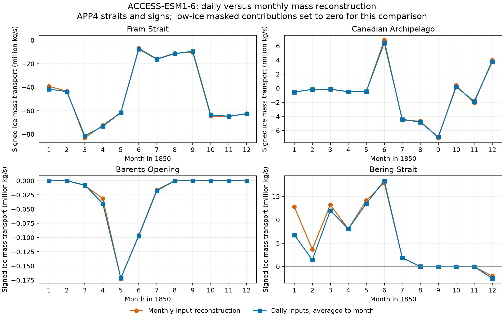

# Issue #772: calculation check with Gadi data

Checked on 2 November 2026 (Australia/Brisbane). The initial analysis below
has now been followed by a production implementation and written-output
tests, described in [Daily production pipeline validation](#daily-production-pipeline-validation).
Gadi archive files were only read; none were changed.

**Current implementation:** ESM1-6 `simassacrossline` now uses daily
`aice/sithick/siu/siv`, computes daily flux before monthly averaging, and
documents the low-ice mask convention. Area transport and legacy ESM1-5
mass retain their APP4 calculations. The initial monthly-method comparison
below is retained as evidence for the switch; see the full-year experiment
and production validation later in this report.

**The proposed area calculation reproduces APP4 on real ESM1-6 data. The
analogous mass calculation reproduces APP4 arithmetic but is not equivalent
to CICE5's native mass diagnostic.** These are separate conclusions.

## Data and scope

- ACCESS-ESM1-6 historical, r1i1p1f1, January–December 1850, grid 300 × 360.
- Published model archive: `/g/data/jq44/access-nri/access-esm1p6/global/historical/r1i1p1f1/2026.06.12/output000/ice/`.
- Corresponding raw output: `/g/data/p73/archive/CMIP7/ACCESS-ESM1-6/production/ensemble-concentrations-historical/historical-historical-1.1-r1i1p1f1-01409bc3/historical-historical-1.1-r1i1p1f1-01409bc3/output000/ice/`.
- Monthly fields: `aice`, `siu`, `siv`, `simass`, `sisnmass`, `sivol`,
  `sidmasstranx`, `sidmasstrany`. All eight fields have identical decoded
  values and missing masks in jq44 and p73 across the full sampled year.
- Daily p73 fields for January and September, restricted to the Arctic
  window covering the four straits, were used for the averaging check.
- APP4 grid: `/g/data/p66/CMIP6/APP_ancils/cice_grid_20101208.nc`.
- Both input manifests identify the model grid as
  `/g/data/vk83/configurations/inputs/access-esm1p6/modern/share/ice/grids/global.1deg/2025.07.29/grid.nc`.
- The archived executable manifest identifies CICE5 release `2026.01.000`.

Exact paths, file sizes/timestamps, grid hashes, executable identification,
source references, and extraction-sample hash are recorded in
[provenance.json](provenance.json). The 21.2 MiB extracted NPZ is retained
locally at `/tmp/issue772_gadi_sample.npz`; it is not committed or permanently
bundled with this report.

The initial calculation check covers one year and one member. Its reference
is APP4's original calculation functions run against these ESM1-6 inputs,
not a published APP4 CMIP6 dataset. The implementation validation below adds
one ESM1-5 month and complete NetCDF output tests; other grids remain unsupported.

## Area calculation: passes APP4 comparison

The tested calculation is

```text
Tx = aice × siu × (hue / 100)
Ty = aice × siv × (hun / 100)
```

Here `aice` is a fraction, velocities are m/s, and the original `hue/hun`
are in cm. Summing the APP4 index segments gives m²/s. The original APP4
functions were extracted unchanged from `app_functions.py`; their `cdms2`
grid-file access was replaced with the actual sampled grid arrays.

The xarray prototype and APP4 give **exactly identical results for all
48 monthly strait values** (maximum absolute difference: 0 m²/s). APP4
uses zero-based inclusive segment endpoints; the port preserves those
endpoints and the native component signs.

Day-weighted annual mean area transport:

| Strait | m²/s |
|---|---:|
| Fram Strait | -36,853.49 |
| Canadian Archipelago | -591.99 |
| Barents Opening | -18.77 |
| Bering Strait | +4,282.77 |

Signs follow APP4's signed component sums, rather than a newly imposed
common import/export convention. Monthly values are in
[monthly_transports.csv](monthly_transports.csv).

## Grid and spatial alignment

The model input grid's `htn/hte` are bit-for-bit equal to APP4's `htn/hte`.
The U coordinates differ by less than 3.8e-8 radians between ancillary
files. APP4 coordinates converted to degrees agree with the history-file
coordinates to within 1.74e-5 degrees over the full grid. This supports
using the original ancillary metrics for this specific model grid.

The current model grid lacks `hun/hue`; they are available in the APP4
ancillary. `HTE/HTN` should not be substituted for them: these describe
different cell edges. Every selected APP4 index is within the domain and
over a wet T cell. The segments contain 18, 9, 21, and 2 points respectively.
[strait_cells.csv](strait_cells.csv) records every index, component,
latitude/longitude, mask value, and edge length.


A four-neighbor T-to-U concentration average was also evaluated strictly as
a sensitivity experiment, with land treated as zero. It changes the annual
Fram area flux from -36,853.49 to -37,349.76 m²/s and the small Barents flux
from -18.77 to -41.48 m²/s. It is not an established correction. Adding this
interpolation alone would change APP4's method and break the matching-index
weighting relationship described below.

## Temporal averaging: the original warning needs qualification

For this CICE5 release, `siu/siv` are **ice-area-weighted** velocities.
The model accumulates `aice*uvel` and `aice*vvel`, then divides by accumulated
`aice`. Thus, away from the ice-presence threshold and masking,

```text
mean(aice) × reported_siu = mean(aice × instantaneous_uvel)
```

This is why a generic objection about multiplying two ordinary monthly
means does not apply directly to this area reconstruction. See the
[release's velocity accumulation](https://github.com/ACCESS-NRI/cice5/blob/cf5df9d4d26265dc5c79e558e5a67834b51fd38d/source/ice_history.F90#L2280-L2302)
and [normalization](https://github.com/ACCESS-NRI/cice5/blob/cf5df9d4d26265dc5c79e558e5a67834b51fd38d/source/ice_history.F90#L2925-L2982).

January and September daily reconstructions, averaged using the actual time
bounds, agree with monthly-input reconstruction to within **0.0018442%**
for nonzero strait values. The largest absolute difference is 0.18457 m²/s
(Fram, September); the January Fram difference is 0.015625 m²/s. Zero cases
are explicitly retained without dividing by zero. The remaining differences
can include finite precision and the different daily/monthly ice-presence
masks; this test does not isolate their individual contributions.

[daily_vs_monthly.csv](daily_vs_monthly.csv) gives all eight comparisons.
Daily reconstruction is a consistency check, not an independent measurement
of true strait transport.


## Mass calculation: APP4 compatibility is not native-diagnostic equivalence

Using `simass` directly as kg/m² in `simass × velocity × edge_length`
matches APP4's ice-mass arithmetic to float32 precision: maximum difference
4 kg/s, or 4.82e-8 of the largest reference magnitude. For this comparison
only, APP4's hard-coded density was canceled by passing `simass/900` to its
`icelineTransports` function. This adapter is not a physical density choice.

The actual sampled `simass/sivol` ratio is **917 kg/m³** within float32
rounding. A production implementation should use `simass` directly; it
should not copy APP4's 900 kg/m³ assumption or multiply `simass` by `aice`
again. `sisnmass` is already kg/m² too.

The native `sidmasstranx/y` metadata explicitly includes both ice and snow.
Summing those diagnostics over the same index segments gives the following
comparison with the reconstructed ice-plus-snow total. This compares two
different discretizations; the percentage is a discrepancy, not an estimate
of the reconstruction's error against physical truth.

| Strait | APP4-style ice + snow, kg/s | Native combined, kg/s | Difference / absolute native |
|---|---:|---:|---:|
| Fram Strait | -46,988,708 | -52,667,744 | +10.78% |
| Canadian Archipelago | -756,953 | -580,327 | -30.44% |
| Barents Opening | -28,736 | -58,196 | +50.62% |
| Bering Strait | +5,932,603 | +5,390,987 | +10.05% |

These are day-weighted annual signed means. Cancellation and small net flux
can magnify relative percentages, particularly at Barents.

The [CICE5 release's mass diagnostic](https://github.com/ACCESS-NRI/cice5/blob/cf5df9d4d26265dc5c79e558e5a67834b51fd38d/source/ice_history.F90#L2318-L2346)
uses T-cell face lengths and neighboring values at each model timestep:

```text
Mx = 0.25 × HTE × (mass[i,j] + mass[i+1,j])
                  × (u[i,j-1] + u[i,j])
My = 0.25 × HTN × (mass[i,j] + mass[i,j+1])
                  × (v[i-1,j] + v[i,j])
```

Here `mass` includes ice and snow; ice-presence gating also applies. This
differs from APP4's indexed product with `hue/hun`. Furthermore, reported
velocities are weighted by ice area, not by ice mass, so the area-flux
averaging identity does not supply an equivalent mass-flux identity.
The native combined diagnostic cannot directly supply ice-only transport.

## Consequences for the proposed fix

1. Proceed with the APP4-compatible **area** implementation for this grid:
   `aice`, `siu`, `siv`, verified `hue/hun`, the original segments, and output
   `(time, line)` with named straits. Document the weighted-velocity semantics.
2. Keep grid identification and ancillary provenance explicit. Do not
   silently substitute T-cell metrics or introduce concentration
   interpolation into the compatibility calculation.
3. Treat **mass** as a separate methodological decision. An APP4-compatible
   approximation using `simass` is reproducible, but this check does not
   justify treating it as equivalent to the native face-flux diagnostic.
   Exact separate ice/snow native transports would require suitable
   separately accumulated diagnostics or sufficient timestep information.
4. Follow with a full integration test for `line` metadata and strings.
   This is now implemented and tested as described below.

## Initial implementation and validation (monthly mass inputs)

Both `siareaacrossline` and `simassacrossline` are implemented and registered
as `calc_line_transport`. ESM1-6 uses `aice` or `simass` with `siu/siv`;
ESM1-5 uses `aice` or `hi × 900 kg m⁻³` with `uvel/vvel`, preserving APP4's
legacy density convention. There is no second concentration or density
factor for ESM1-6 `simass`. The mass output explicitly records that it is
an ice-only reconstruction that approximates the time-mean mass flux.

The 50 required ancillary points are bundled with source provenance.
The calculation verifies the full grid shape and all selected T/U
coordinates before applying fixed indices. The sea-ice pipeline now handles
the generated `(time, line)` variable, preserves time bounds, writes the
four character strait labels, and removes gridded coordinates/cell measures.

Validation completed:

- **457 tests passed** on the PR branch based on `main` at `24d12577`,
  including 22 new numerical and pipeline cases (451 passed before rebasing).
  These cover both mappings, CMIP6/CMIP7 writes, file and xarray inputs,
  eager/lazy calculation, units, grid rejection, time alignment, flow signs,
  missing values, and ice-density handling. Ruff and `git diff --check` pass.
- The actual file-loading/writing path was run on the retained ESM1-6
  1850 sample and ESM1-5 December 1860 from
  `/g/data/p73/archive/CMIP6/ACCESS-ESM1-5/HI-05/history/ice/iceh.1860-12.nc`.
  Reconstructed input NetCDFs preserve the sampled values and relevant
  source metadata. These are local validation outputs; the illustrative
  ESM1-5 parent metadata is not a provenance approval for publication.
- All six output files agree with the original APP4 calculation to
  float32 rounding. Maximum absolute differences are shown below. The
  largest difference divided by the largest reference magnitude is
  **1.14 × 10⁻⁷ or less**. The vectorised production summation need not be
  bit-for-bit identical to the earlier prototype's accumulation order.
- Both ESM1-5 CMIP6 outputs pass **PrePARE: 2 files scanned, 0 errors**
  against the bundled `CMIP6_SImon.json` table.
- Both ESM1-6 CMIP7 outputs pass `cmip7repack` and range checks and have
  **no high-priority failures** in `wcrp_cmip7:1.0`.

| Sample | Formats checked | Area maximum difference (m²/s) | Mass maximum difference (kg/s) |
|---|---|---:|---:|
| ESM1-6, 12 months | CMIP6 and CMIP7 | 0.0078125 | 8 |
| ESM1-5, 1 month | CMIP6 | 0.00390625 | 4 |

These are not unconditional compliance passes. The WCRP checker reports a
medium-priority missing `cell_measures` attribute for reduced line variables,
although the CMOR table specifies no cell measure. The CF checker raises an
exception in `check_geographic_region` while interpreting the array of four
character labels (`expected str instance, numpy.ndarray found`), so that
check is incomplete. It also flags the CMOR `line(line, string_length)` naming
and, for CMIP7, using its CF-1.11 suite on a CF-1.12 file. The unit and real-data
tests independently verify the four canonical strait labels and their encoding.
The CMIP6 WCRP registry additionally reports table/registry disagreements;
ESM1-6 is also absent from its CMIP6 model CV. Checker failures and exit
codes are retained in [implementation_validation.json](implementation_validation.json).
Do not interpret these results as scientific approval of the mass approximation
or as a clean CF checker run.

The reproduction script is [verify_implementation.py](verify_implementation.py).
After extracting the modern sample and downloading APP4 as below, extract
the legacy sample and run:

```bash
ssh -x -F ~/.ssh/config -o BatchMode=yes -o ClearAllForwardings=yes gadi_rb5533 \
  'module use /opt/Modules/modulefiles; module load conda/analysis3-26.10; python -' \
  < reports/issue_772_transport_check/extract_esm15.py \
  > /tmp/issue772_esm15_sample.npz

PATH="$PWD/.pixi/envs/dev/bin:$PATH" .pixi/envs/dev/bin/python \
  reports/issue_772_transport_check/verify_implementation.py

PATH="$PWD/.pixi/envs/dev/bin:$PATH" .pixi/envs/dev/bin/python -m pytest \
  tests/unit/test_seaice_line_transport.py tests/unit/test_sea_ice.py \
  tests/unit/test_derivations_calc_seaice.py tests/unit/test_derivations.py \
  tests/unit/test_driver.py tests/unit/test_utilities_mappings.py \
  tests/unit/test_mapping_resolution.py -q --disable-warnings

UDUNITS2_XML_PATH="$PWD/.pixi/envs/dev/share/udunits/udunits2.xml" \
  .pixi/envs/dev/bin/PrePARE \
  --table-path src/access_moppy/vocabularies/cmip6_cmor_tables/Tables/CMIP6_SImon.json \
  --max-processes 1 --hide-progress --no-text-color \
  reports/issue_772_transport_check/outputs/CMIP6/CMIP/CSIRO/ACCESS-ESM1-5/historical/r1i1p1f1/SImon/*/gn/v*/*.nc
```

## Full-year daily mass reconstruction: 1850

The follow-up experiment reads all **365 daily records and 12 monthly
records**, at the 50 strait contributions, from the same ESM1-6 historical
member in p73. It changes temporal sampling only: APP4 geometry, native
component signs, and ice-only mass are retained. This experiment motivated
the subsequent ESM1-6 production switch to daily inputs, validated below.

For each day the calculation is

```text
mass_per_grid_area = 917 kg m⁻³ × aice × sithick
transport = sum(mass_per_grid_area × native velocity × hue_or_hun)
```

Daily transports are averaged using the actual time-bound durations, then
compared with transport calculated from monthly `simass` and `siu/siv`.
The source's `sithick` is an ice-area-weighted thickness; monthly
`917 × aice × sithick` reproduces archived `simass` where thickness is
unmasked to within 0.000238 kg/m². The calculation uses float64 arithmetic
to avoid confusing accumulation rounding with temporal-sampling effects.
The monthly sample and January/September daily samples exactly match the
independently extracted inputs from the earlier analysis.

Annual signed means, in **million kg/s**, under the explicit low-ice
mask convention described below:

| Strait | Monthly inputs | Daily inputs | (Daily − monthly) / abs(monthly) |
|---|---:|---:|---:|
| Fram Strait | -44.705499 | -44.827950 | -0.27% |
| Canadian Archipelago | -0.751427 | -0.789446 | -5.06% |
| Barents Opening | -0.027145 | -0.028005 | -3.17% |
| Bering Strait | +5.818669 | +4.974278 | -14.51% |

The annual Fram difference is small because monthly differences partly
cancel: June changes by -9.56% and September by +8.11% relative to the
absolute monthly-input transport. At Bering the daily estimate is 46.96%
lower in January and 60.78% lower in February. Those two months have **no
masked inputs**. Canadian Archipelago October differs by -52.93%, but its
small net flow makes that relative percentage sensitive to cancellation.
These are method differences, not estimated errors against true transport.



### Distinguishing covariance from masks

To check the cause, a second monthly estimate is built by first averaging
daily reconstructed mass and ice-area-weighting the daily velocities,
then multiplying the two monthly values. The difference between daily
flux averaging and this coarsened estimate isolates between-day
thickness/velocity covariance under the chosen mask convention. The
remaining difference from the archived monthly-input result includes
masking and finite-precision effects.

| Strait | Annual daily − monthly (kg/s) | Between-day covariance term (kg/s) | Remaining archive/coarsening difference (kg/s) |
|---|---:|---:|---:|
| Fram Strait | -122,450.52 | -122,706.93 | +256.40 |
| Canadian Archipelago | -38,018.14 | -38,018.16 | +0.02 |
| Barents Opening | -860.18 | -1,271.54 | +411.36 |
| Bering Strait | -844,391.34 | -844,241.87 | -149.47 |

Thus, averaging mass and velocity separately explains nearly all the
Fram, Canadian, and Bering differences. Masking/coarsening effects are
material for the much smaller Barents result. Restricting Bering to the
fully unmasked January–June period still gives a **13.81% decrease**, so
the large temporal-sampling difference is not created by filling summer
missing values.

### Mask convention and remaining limits

All concentration values at these points are present. There are 2,413
masked daily flux contributions out of 18,250 point-days; every one has
ice concentration below 0.001 (0.1%), with a maximum of 0.000997526.
Thickness and velocity masks match. For the numerical comparison above,
these missing contributions are assigned zero, with no renormalization
over available days. This is a diagnostic convention, **not proof of
physically zero transport**.

Bering has 90 days with every strait contribution masked, and September,
October, and November are wholly masked in the monthly reconstruction.
The original monthly missing-preserving calculation does not directly
yield a complete annual Bering mean. The annual value above is
conditional on the explicit zero convention. Missing-preserving monthly
alternatives and all coverage counts are retained in the linked tables.
The new daily implementation explicitly adopts this low-ice zero convention
and records it in each output file. Other missing contributions propagate
to the strait-month; days with missing data are never silently omitted.

Daily reconstruction recovers variability between days, but still misses
within-day thickness/velocity covariance and retains APP4's spatial
approximation. There is no independent ice-only model flux available here
to establish its absolute accuracy. This result supports using daily inputs
as a better temporal approximation for this archive, particularly at Bering;
it does not establish exact native flux or validate other years or models.

Artifacts:

- [Annual comparison](daily_year/annual_comparison.csv),
  [48 monthly comparisons](daily_year/monthly_comparison.csv),
  [daily series](daily_year/daily_transport.csv), and
  [mask coverage](daily_year/mask_coverage.csv).
- [Results and checks](daily_year/results.json) and
  [source files, attributes, and checksums](daily_year/provenance.json).
- [PNG figure](daily_year/daily_vs_monthly_mass.png) and
  [PDF figure](daily_year/daily_vs_monthly_mass.pdf).

Reproduce from the repository root:

```bash
ssh -x -F ~/.ssh/config -o BatchMode=yes -o ClearAllForwardings=yes gadi_rb5533 \
  'module use /opt/Modules/modulefiles; module load conda/analysis3-26.10; OPENBLAS_NUM_THREADS=1 OMP_NUM_THREADS=1 python -' \
  < reports/issue_772_transport_check/daily_year/extract.py \
  > /tmp/issue772-daily-year-1850.npz

MPLCONFIGDIR=/tmp/issue772-mpl .pixi/envs/dev/bin/python \
  reports/issue_772_transport_check/daily_year/analyse.py \
  /tmp/issue772-daily-year-1850.npz
```

The compressed strait sample is approximately 210 KiB. Extraction only
reads Gadi files and streams the sample to the local machine.

## Daily production pipeline validation

**843 targeted regression tests pass**, including 58 strait-transport tests.
They cover multiplication before averaging, low-ice versus unknown masks,
missing days, complete-month enforcement, units, lazy arrays, leap/no-leap/
360-day calendars, daily discovery in both archive layouts, and CMIP6/CMIP7
file writes with generic resampling enabled. The changed sea-ice derivation
module has 95% coverage in this targeted run. See
[regressions.log](daily_year/regressions.log).

`daily_year/verify_pipeline.py` exercises automatic daily file discovery,
loading, derivation, and writing for both CMIP6 and CMIP7. It builds 12
input NetCDFs containing the actual sampled strait values at their original
300 × 360 indices; unsampled cells are missing. This limits the transferred
data without inventing any strait contributions.

Both written files contain 12 monthly records and four correctly labelled
straits, with calendar-month bounds and midpoint times. Against the
independent float64 daily-year calculation, the largest absolute difference
is **3.95 kg/s for CMIP6** and **2.13 kg/s for CMIP7**, consistent with
float32 input arithmetic/encoding. CMIP7 repacking and range checks pass.
The existing checker limitations remain: reduced line `cell_measures`, the
CF vector-of-character-region exception, and CMIP6 CV/registry disagreements.
See [pipeline_validation.json](daily_year/pipeline_validation.json) for
the exact failures and output paths; this is not a clean CF compliance pass.

The ESM1-6 mapping declares `input_frequency: day` and prevents generic
input averaging before the daily calculation. Monthly input files,
missing days, overlapping bounds, and partial calendar months fail with
an explanatory error. The ESM1-5 mass and both models' area paths retain
their previous inputs. The earlier `verify_implementation.py` now checks
those unchanged paths; ESM1-6 mass is checked by:

```bash
PATH="$PWD/.pixi/envs/dev/bin:$PATH" .pixi/envs/dev/bin/python \
  reports/issue_772_transport_check/daily_year/verify_pipeline.py
```

## Reproduction

The extraction reads model data and grids and writes only a compressed
archive to stdout. It does not submit a job or write anything on Gadi.
The module-path addition below fixes the missing `singularity` module in
this account's noninteractive SSH environment without changing its files.

```bash
ssh -x -F ~/.ssh/config -o BatchMode=yes -o ClearAllForwardings=yes gadi_rb5533 \
  'module use /opt/Modules/modulefiles; module load conda/analysis3-26.10; OPENBLAS_NUM_THREADS=1 OMP_NUM_THREADS=1 python -' \
  < reports/issue_772_transport_check/extract_gadi.py \
  > /tmp/issue772_gadi_sample.npz

curl -fsSL https://raw.githubusercontent.com/ACCESS-Community-Hub/APP4/master/subroutines/app_functions.py \
  -o /tmp/issue772-app_functions.py

MPLCONFIGDIR=/tmp/issue772-mpl .pixi/envs/dev/bin/python \
  reports/issue_772_transport_check/check_transport.py \
  /tmp/issue772_gadi_sample.npz /tmp/issue772-app_functions.py
```

Check the reference-source hash in `provenance.json` when reproducing: the
download URL uses APP4's master branch. Numerical output is saved in
[results.json](results.json), with the complete monthly and daily tables
linked above.
